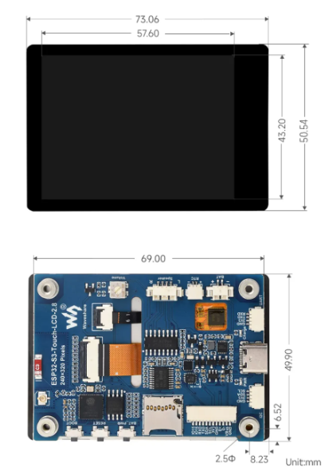
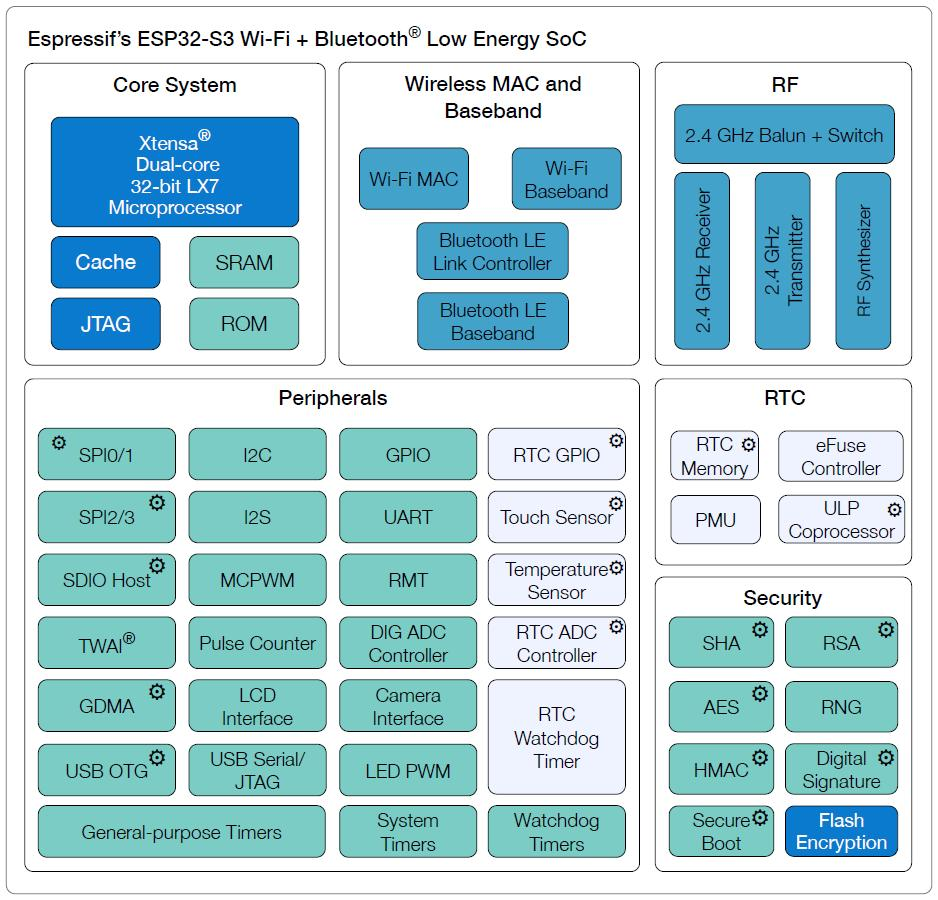
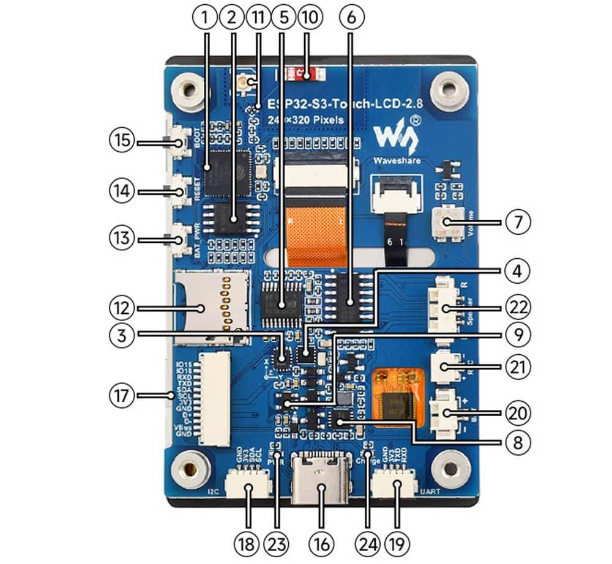
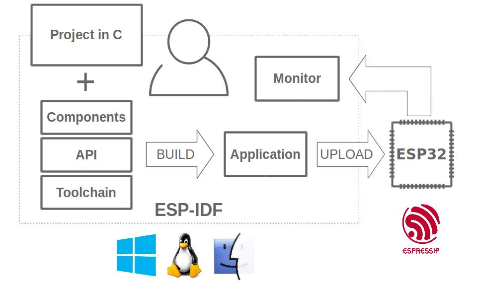
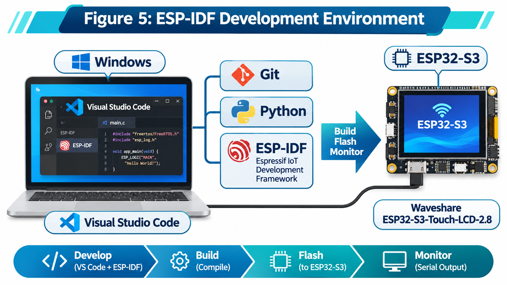
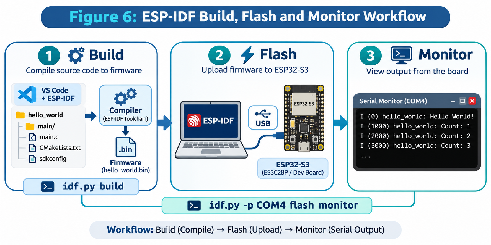
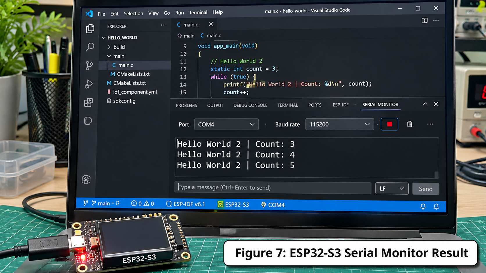

# ND01 Mini-Project #1

**KMUTT ND69 — Learning Summary (Week 01–05)**

## 1. Introduction
This repository contains my learning summary for ND01 Mini-Project #1.

## 2. Weekly Learning Summary


### Week 01: Introduction

#### 1. Summary

สัปดาห์ที่ 1 เป็นการแนะนำภาพรวมของหลักสูตร ND01
ภายใต้โครงการ KMUTT ND69 โดยมุ่งเน้นการเรียนรู้
ด้าน Electronics และ Embedded Systems

บทเรียนนี้เป็นจุดเริ่มต้นสำหรับการศึกษาระบบสมองกลฝังตัว
และเตรียมความพร้อมสำหรับการเรียนรู้ในสัปดาห์ถัดไป


#### Hardware Overview

ภาพแสดงขนาดทางกายภาพของจอแสดงผลและ
แผงวงจรที่ใช้ในการศึกษา Embedded Systems



**Figure 1:** Physical dimensions of the
development board and display module.

จากภาพ จอแสดงผลมีขนาดภายนอกประมาณ
73.06 × 50.54 mm และแผงวงจรด้านหลัง
มีขนาดประมาณ 69.00 × 49.90 mm


#### 2. Key Concepts

- Course Introduction:
  ภาพรวมของหลักสูตร ND01

- Electronics:
  ขอบเขตการเรียนรู้ด้านอิเล็กทรอนิกส์

- Embedded Systems:
  ขอบเขตการเรียนรู้ด้านระบบสมองกลฝังตัว

- Learning Roadmap:
  แนวทางการเรียนรู้ในสัปดาห์ถัดไป

#### 3. Learning Roadmap

หัวข้อที่ระบุในเอกสาร Week 01 ได้แก่

- Week 02:
  ES3C28P Board Hardware and Embedded Fundamentals
  จำนวน 15 บทเรียน

- Week 03:
  Installation and Verification of ESP-IDF
  บน Windows, macOS และ Linux

#### 4. Learning Reflection

Week 01 ทำให้เห็นภาพรวมของหลักสูตร ND01
และลำดับการเรียนรู้ด้าน Electronics และ Embedded Systems

การศึกษาเนื้อหาในสัปดาห์ต่อไปจะช่วยพัฒนา
ความเข้าใจเกี่ยวกับ Hardware และเครื่องมือ
สำหรับการพัฒนาระบบ Embedded Systems

#### 5. References

- [Week 01 Course Materials](https://github.com/drsanti/kmutt-nd69/tree/main/nd1/docs/week01)
- [Week 01 Presentation](https://canva.link/8hgvsk8cixlah8p)


### Week 02: ES3C28P Hardware & Embedded Fundamentals

#### 1. Summary

สัปดาห์ที่ 2 ศึกษาพื้นฐาน Hardware และ Embedded Systems
ผ่านบอร์ด ES3C28P ซึ่งใช้ไมโครคอนโทรลเลอร์ ESP32-S3R8

เนื้อหาประกอบด้วย 15 บทเรียน โดยเรียงลำดับจาก
สถาปัตยกรรมชิป หน่วยความจำ อุปกรณ์บนบอร์ด
ไปจนถึงเครื่องมือและภาษาโปรแกรมสำหรับพัฒนา Firmware

การเรียนรู้แบ่งออกเป็น 3 ส่วนหลัก ได้แก่

1. Chip Architecture
2. Board Hardware and Peripherals
3. Firmware Development Fundamentals

#### 2. Chip Architecture (Lessons 01–05)

**Lesson 01: ESP32-S3R8 Chip**
- ศึกษาชิป ESP32-S3 ที่ใช้บนบอร์ด ES3C28P
- ทำความรู้จักองค์ประกอบพื้นฐานของไมโครคอนโทรลเลอร์




**Figure 2:** ESP32-S3 Architecture and Memory System.


**Lesson 02: ESP32 History**
- ศึกษาพัฒนาการจาก ESP8266 ถึง ESP32-S3
- ทำความเข้าใจภาพรวมของตระกูล ESP32

**Lesson 03: Memory Types**
- RAM, SRAM และ PSRAM
- Flash Memory และ ROM
- eFuse Memory

**Lesson 04: Firmware Memory**
- Heap และ Stack
- Flash Partition
- Non-Volatile Storage (NVS)

**Lesson 05: ESP-IDF Toolchain**
- ทำความรู้จัก ESP-IDF
- เครื่องมือสำหรับพัฒนา Firmware บน ESP32

#### 3. Board Hardware (Lessons 06–13)

**Lesson 06: USB and Serial**
- ระบบ USB/Serial ของบอร์ด
- ข้อควรระวังจากการไม่มีชิป USB-UART แยก




**Figure 3:** ES3C28P Board Hardware Components.


**Lesson 07: Power and Battery**
- วงจรชาร์จแบตเตอรี่ TP4054
- วงจรควบคุมแรงดัน LDO
- การวัดแรงดันแบตเตอรี่ผ่าน ADC

**Lesson 08: TFT Display**
- จอ ILI9341V
- ความละเอียด 240 × 320 pixels
- การสื่อสารผ่าน SPI

**Lesson 09: Touch Screen**
- ชิป FT6336G
- Capacitive Touch
- การสื่อสารผ่าน I2C

**Lesson 10: Audio System**
- ES8311 Audio Codec
- FM8002E Audio Amplifier
- MEMS Microphone

**Lesson 11: RGB LED**
- WS2812 Addressable RGB LED
- ความสำคัญของ Timing
- การใช้งาน RMT Peripheral

**Lesson 12: MicroSD**
- การเชื่อมต่อ MicroSD
- SDIO แบบ 4-bit

**Lesson 13: GPIO and Expansion**
- Expansion Header
- GPIO Pin Mapping
- การตรวจสอบขาที่ใช้งานได้และขาที่มีข้อจำกัด

#### 4. Firmware Development (Lessons 14–15)




**Figure 4:** ESP-IDF Firmware Development Workflow.


**Lesson 14: ESP-IDF Installation**
- ติดตั้ง ESP-IDF ผ่าน Visual Studio Code
- เตรียมเครื่องมือสำหรับพัฒนา Firmware
- แนวทางทดสอบบนบอร์ดจริง

**Lesson 15: Embedded C and FreeRTOS**
- ทบทวนพื้นฐานภาษา Embedded C
- แนวคิดการจัดการ Task
- พื้นฐาน FreeRTOS สำหรับ Embedded Systems

#### 5. Key Concepts

แนวคิดสำคัญที่ได้จากการศึกษาเนื้อหาประกอบด้วย

- Microcontroller Architecture
- Memory Management
- GPIO and Peripheral Interfaces
- SPI, I2C, USB และ SDIO
- Power Management
- ESP-IDF Development Environment
- Embedded C and FreeRTOS

#### 6. Learning Reflection

จากการศึกษาเนื้อหา Week 02 ทำให้เห็นว่า
การพัฒนา Embedded Systems จำเป็นต้องเข้าใจ
ทั้งโครงสร้าง Hardware และ Software ร่วมกัน

การศึกษาส่วนประกอบของบอร์ด ES3C28P
ช่วยให้เข้าใจความสัมพันธ์ระหว่างไมโครคอนโทรลเลอร์
หน่วยความจำ จอแสดงผล ระบบสัมผัส และอุปกรณ์ต่อพ่วง

ความรู้เหล่านี้เป็นพื้นฐานสำหรับการศึกษา ESP-IDF
และการพัฒนา Firmware ในบทเรียนถัดไป

#### 7. References

- [Week 02 Course Materials](https://github.com/drsanti/kmutt-nd69/tree/main/nd1/docs/week02)
- [Thai Lessons](https://github.com/drsanti/kmutt-nd69/tree/main/nd1/docs/week02/lessons)
- [English Lessons](https://github.com/drsanti/kmutt-nd69/tree/main/nd1/docs/week02/lessons/EN)
- [Course Illustrations](https://github.com/drsanti/kmutt-nd69/tree/main/nd1/docs/week02/lessons/images)


### Week 03: ESP-IDF Setup and ESP32-S3 Hello World

#### 1. Summary

สัปดาห์ที่ 3 ศึกษาการติดตั้งและใช้งาน ESP-IDF
สำหรับพัฒนา Firmware บนไมโครคอนโทรลเลอร์ ESP32-S3

เนื้อหาครอบคลุมการเตรียม Development Environment
การใช้งาน Visual Studio Code การ Build Firmware
การ Flash โปรแกรม และการตรวจสอบผ่าน Serial Monitor

#### 2. Development Environment

เครื่องมือที่ใช้ในการพัฒนา ได้แก่

- Operating System: Windows
- IDE: Visual Studio Code
- Framework: Espressif IoT Development Framework (ESP-IDF)
- Programming Language: C
- Target Microcontroller: ESP32-S3
- Development Board: Waveshare ESP32-S3-Touch-LCD-2.8

ESP-IDF เป็น Framework สำหรับพัฒนา Embedded Software
โดยประกอบด้วย Libraries, Build System และเครื่องมือ
ที่ช่วยให้สามารถพัฒนา Firmware สำหรับ ESP32 ได้



**Figure 5:** ESP-IDF Development Environment.

#### 3. ESP-IDF Architecture

องค์ประกอบสำคัญในการพัฒนา ได้แก่

**ESP-IDF Framework**
- จัดเตรียม API และ Libraries สำหรับควบคุม Hardware
- รองรับ Peripheral และ FreeRTOS

**Compiler Toolchain**
- แปลง Source Code ให้เป็น Machine Code
- สร้างไฟล์ Firmware สำหรับไมโครคอนโทรลเลอร์

**Python Environment**
- ใช้สำหรับรันเครื่องมือและ Build Scripts
- สนับสนุนการทำงานของ idf.py

**Firmware Project**
- จัดเก็บ Source Code และ Configuration
- ประกอบด้วยไฟล์ CMake และโฟลเดอร์ main

#### 4. Practical Exercise: Hello World

การทดลองนี้ใช้บอร์ด ESP32-S3 จริง
เพื่อศึกษากระบวนการพัฒนา Firmware

ขั้นตอนการทำงาน:

1. เปิดโปรเจกต์ใน Visual Studio Code
2. เตรียม ESP-IDF Development Environment
3. ตั้งค่า Target เป็น ESP32-S3
4. Build Firmware
5. เชื่อมต่อบอร์ดผ่าน USB
6. Flash Firmware ลงบอร์ด
7. เปิด Serial Monitor
8. ตรวจสอบข้อความที่ส่งจากไมโครคอนโทรลเลอร์

ตัวอย่างคำสั่ง ESP-IDF:

```bash
idf.py --version
idf.py set-target esp32s3
idf.py build
idf.py -p COM4 flash monitor
```

หมายเหตุ: COM4 เป็นพอร์ตที่เคยใช้ในการทดลอง
และต้องตรวจสอบหมายเลขพอร์ตจริงก่อนใช้งานอีกครั้ง



**Figure 6:** ESP-IDF Build, Flash and Monitor Workflow.

#### 5. Experimental Results

จากการทดลองก่อนหน้านี้ สามารถพัฒนาและทดสอบ
โปรแกรม Hello World บน ESP32-S3 ได้สำเร็จ

ผลการทดลองที่เคยบันทึกไว้:

- Build Firmware: Successful
- Flash Firmware: Successful
- Serial Monitor: Successful

ตัวอย่างข้อความที่แสดงผ่าน Serial Monitor:

```text
Hello World 2 | Count: 3
Hello World 2 | Count: 4
Hello World 2 | Count: 5
```

ผลลัพธ์แสดงให้เห็นว่าไมโครคอนโทรลเลอร์สามารถ
รัน Firmware และส่งข้อความผ่าน Serial Interface ได้



**Figure 7:** ESP32-S3 Serial Monitor Illustration (Simulated).

#### 6. Key Concepts

- ESP-IDF Development Framework
- Compiler Toolchain
- Python Development Environment
- Firmware Build Process
- Flash Memory Programming
- Serial Communication
- ESP32-S3 Hardware Testing

#### 7. Learning Reflection

การทดลองนี้ช่วยให้เข้าใจกระบวนการพัฒนา
Embedded Firmware ตั้งแต่การเตรียมเครื่องมือ
การเขียนโปรแกรม การ Compile และ Build
ไปจนถึงการ Flash ลงบนไมโครคอนโทรลเลอร์จริง

นอกจากนี้ยังเห็นความสำคัญของ Serial Monitor
ในการตรวจสอบการทำงานและวิเคราะห์ปัญหา
ระหว่างพัฒนา Embedded Systems

#### 8. References

- [Week 03 Course Materials](https://github.com/drsanti/kmutt-nd69/tree/main/nd1/docs/week03)
- [ESP-IDF Documentation](https://docs.espressif.com/projects/esp-idf/en/stable/esp32s3/)


### Week 04: Onsite Workshop — ESP32-S3 Hardware and Firmware Deployment

#### 1. Summary

สัปดาห์ที่ 4 เป็นการเรียนรู้แบบ Onsite Workshop
โดยได้รับบอร์ด ESP32-S3 สำหรับฝึกปฏิบัติจริง

กิจกรรมมุ่งเน้นการเชื่อมต่อบอร์ดเข้ากับคอมพิวเตอร์
การเตรียมสภาพแวดล้อมสำหรับพัฒนาโปรแกรม
และการฝึก Deploy Firmware ลงบน Hardware

#### 2. Hardware Preparation

กิจกรรมการเรียนรู้ประกอบด้วย

- รับและตรวจสอบบอร์ด ESP32-S3
- ศึกษาส่วนประกอบและการเชื่อมต่อของบอร์ด
- เชื่อมต่อบอร์ดกับคอมพิวเตอร์ผ่าน USB
- ตรวจสอบการเชื่อมต่อ Serial Port
- เตรียมเครื่องมือสำหรับ Upload Firmware

#### 3. Firmware Deployment Practice

ศึกษาขั้นตอนการนำโปรแกรมจากคอมพิวเตอร์
ไปทำงานบนไมโครคอนโทรลเลอร์จริง

กระบวนการประกอบด้วย

1. เปิดโปรเจกต์ Firmware
2. ตรวจสอบ Source Code
3. ตั้งค่า Target Microcontroller
4. Build โปรแกรม
5. Flash หรือ Upload Firmware
6. ตรวจสอบการทำงานผ่าน Serial Monitor

#### 4. Key Concepts

- ESP32-S3 Development Board
- Hardware Connection
- USB and Serial Communication
- Firmware Deployment
- Build and Flash Process
- Hardware Testing

#### 5. Learning Reflection

การเรียนรู้แบบ Onsite ช่วยให้เข้าใจความสัมพันธ์
ระหว่าง Software และ Hardware มากขึ้น

ได้ฝึกกระบวนการนำ Source Code
มาสร้างเป็น Firmware และ Upload
ลงบนไมโครคอนโทรลเลอร์จริง

ประสบการณ์นี้เป็นพื้นฐานสำคัญสำหรับ
การพัฒนาโปรแกรมด้วยตนเองใน Week 05


### Week 05
- Summary:
- Key concepts:
- What I learned:

## 3. Practical Exercises
Describe the exercises completed and include screenshots or code examples.

## 4. Learning Reflection
Describe the challenges, solutions, and knowledge gained.

## 5. References
- https://github.com/drsanti/kmutt-nd69
  
